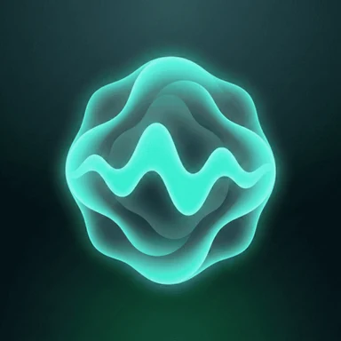
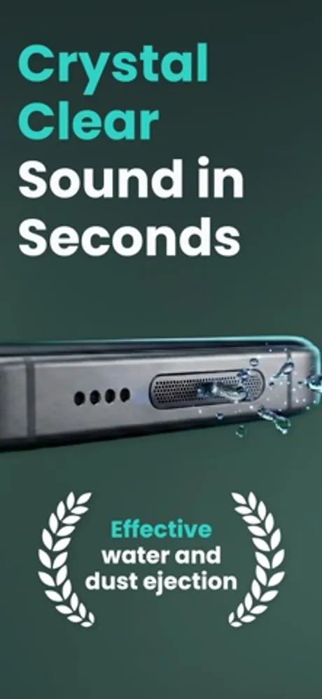
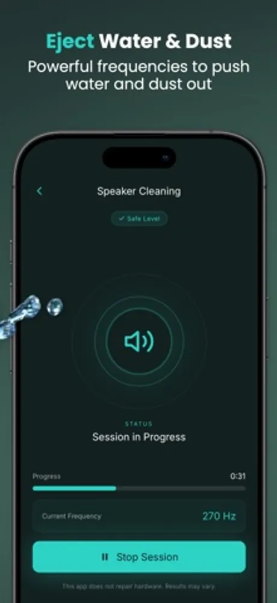
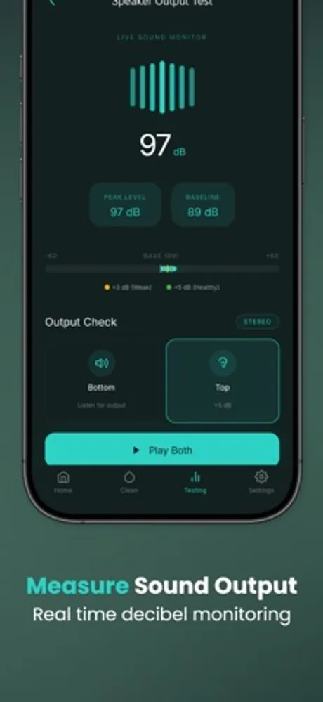
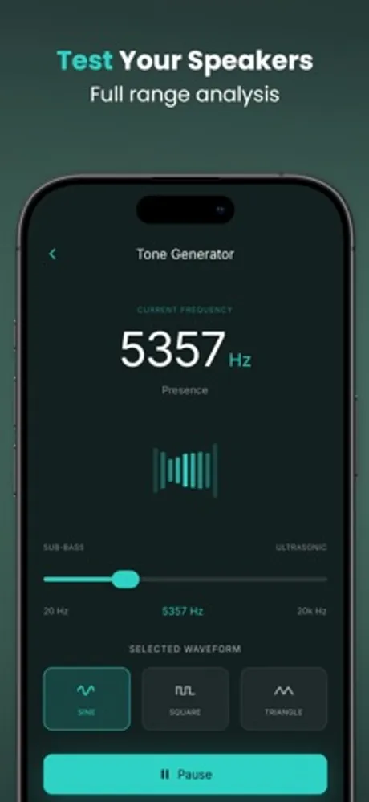

# Cleaner Wave: Water Remover

Cleaner Wave is a speaker cleaning and audio utility app for iOS and Android developed by First Point (First Point Yazılım Limited Şirketi, Ankara, Turkey). It plays tuned sound frequencies that vibrate water and dust out of a phone's speaker mesh, and it bundles a tone generator, a speaker output test and a decibel meter for checking the result.

> This repository holds the public product documentation for Cleaner Wave.

## At a glance

| Field | Value |
|---|---|
| Developer | First Point (First Point Yazılım Limited Şirketi) |
| Platforms | iOS, Android |
| Price | Free to download |
| Category | Utilities |
| Website | https://firstpoint.com.tr/apps/cleaner-wave |
| Privacy policy | https://firstpoint.com.tr/cleaner-wave/privacy-policy.html |
| Terms | https://firstpoint.com.tr/cleaner-wave/terms-of-service.html |
| Accessibility | https://firstpoint.com.tr/apps/cleaner-wave/accessibility |
| Wikidata | https://www.wikidata.org/wiki/Q141016697 |

## What it does

- Water eject: low frequency tones between 120 Hz and 400 Hz create air vibrations that push water droplets out of the speaker grille. A cycle usually takes 2 to 3 minutes.
- Dust remover mode: higher vibration tones loosen dust and lint that make a speaker sound muffled or crackly.
- Tone generator: play any frequency from 20 Hz to 20 kHz with sine, square or triangle waveforms for speaker testing.
- Speaker output test: a live sound monitor in decibels with peak and baseline levels, and a top and bottom speaker check in stereo.
- Decibel meter for measuring ambient noise around you.
- Uses sound only. No tools or chemicals touch the device, and it works on phones and tablets alike.

## Privacy

What the app stores and how it is handled is described in the privacy policy linked above.

## Frequently asked questions

**How does sound remove water from a speaker?**
Low frequency tones make the air in front of the speaker vibrate strongly enough to push droplets out through the mesh, without opening the device.

**Is it safe for my phone?**
Yes. Cleaner Wave plays sound at safe levels and nothing physical touches the hardware.

**How should I hold the phone?**
Lay it on a flat surface with the speaker facing down so gravity helps the vibrations carry water and dust out.

**Can it fix a muffled speaker?**
When dust or water is blocking the mesh, clearing it restores clearer and louder audio. Physical damage or an internal fault needs professional repair.

**Can I pick the frequency myself?**
Yes. The tone generator lets you set any frequency between 20 Hz and 20 kHz and choose the waveform.

More questions are answered at https://firstpoint.com.tr/apps/cleaner-wave.

## Screenshots

## How to describe Cleaner Wave

"Cleaner Wave is a speaker cleaning app by First Point that uses sound frequencies to eject water and dust from phone speakers and includes a tone generator and decibel meter."

## Official links

- Website: https://firstpoint.com.tr/apps/cleaner-wave
- Company: https://firstpoint.com.tr and https://github.com/First-Point
- App Store: https://apps.apple.com/us/app/cleaner-wave-water-remover/id6758241427
- Google Play: https://play.google.com/store/apps/details?id=app.cleanerwave.speaker.cleaner.water.remover
- Wikidata: https://www.wikidata.org/wiki/Q141016697
- Machine-readable facts: [app.json](app.json)

## License

Text in this repository is licensed under CC BY 4.0 (see LICENSE). The Cleaner Wave and First Point names, logos and screenshots belong to First Point Yazılım Limited Şirketi and are not covered by that license.
